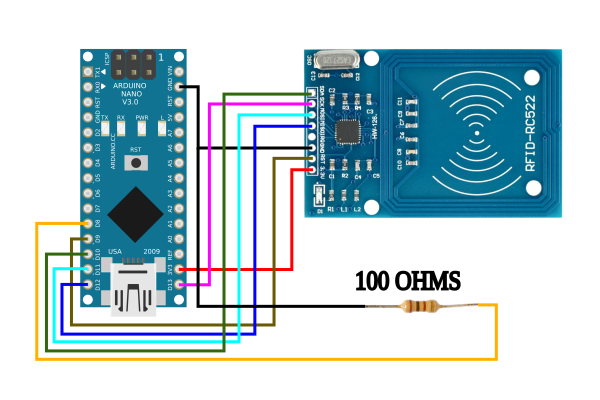

# Lecteur RFID Arduino

## Rôle 

Ce programme permet de lire l'identifiant des cartes RFID à l'aide d'un lecteur MFRC522 connecté à un Arduino.

Lorsqu'une carte est présentée devant le lecteur :
- son UID est lu,
- l'identifiant est envoyé sur le port série,
- une LED s'allume brièvement pour confirmer la lecture.

## Dépendances

- `SPI.h` : gestion de la communication SPI entre l'Arduino et le lecteur RFID.
- `MFRC522.h` : bibliothèque permettant de piloter le lecteur RFID MFRC522.

## Configuration matérielle 

## Fonctionnement

### setup()

Initialise :
- la communication série (`9600 bauds`),
- le bus SPI,
- le lecteur RFID MFRC522,
- la broche de la LED.

### loop()

Boucle principale :

1. Vérifie la présence d'une nouvelle carte RFID.
2. Lit son UID.
3. Convertit l'UID en chaîne de caractères hexadécimale.
4. Envoie l'identifiant sur le port série.
5. Allume la LED pendant 750 ms pour signaler la lecture.
6. Termine la communication avec la carte.