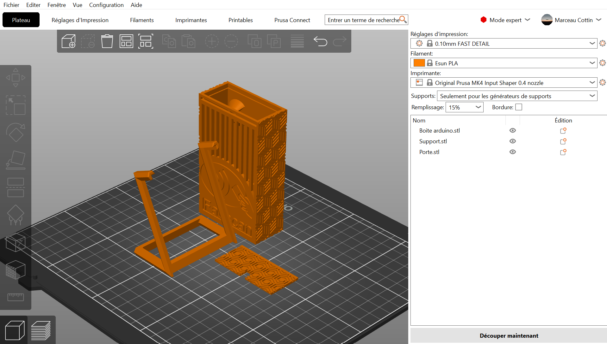
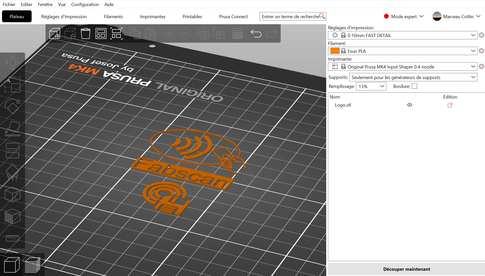
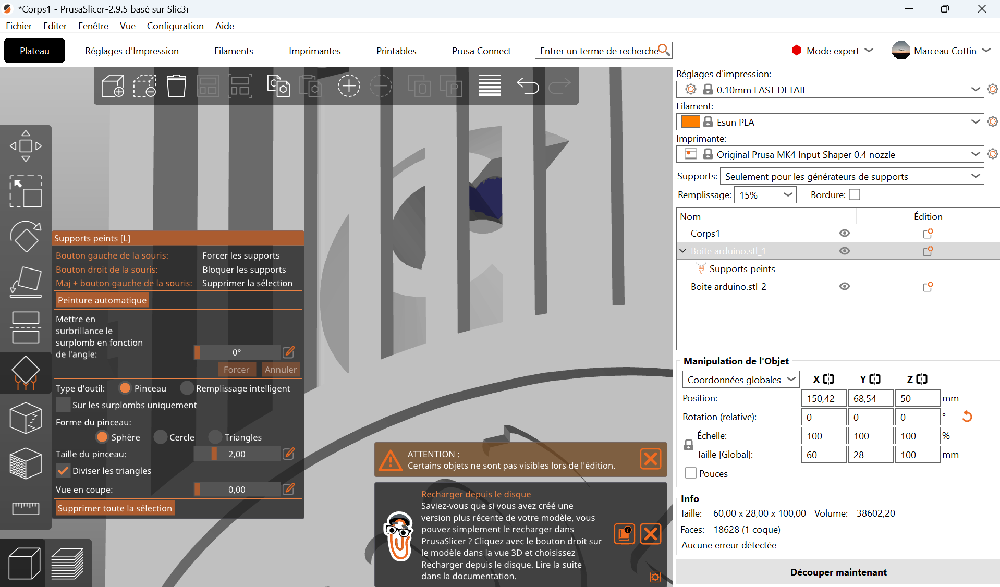
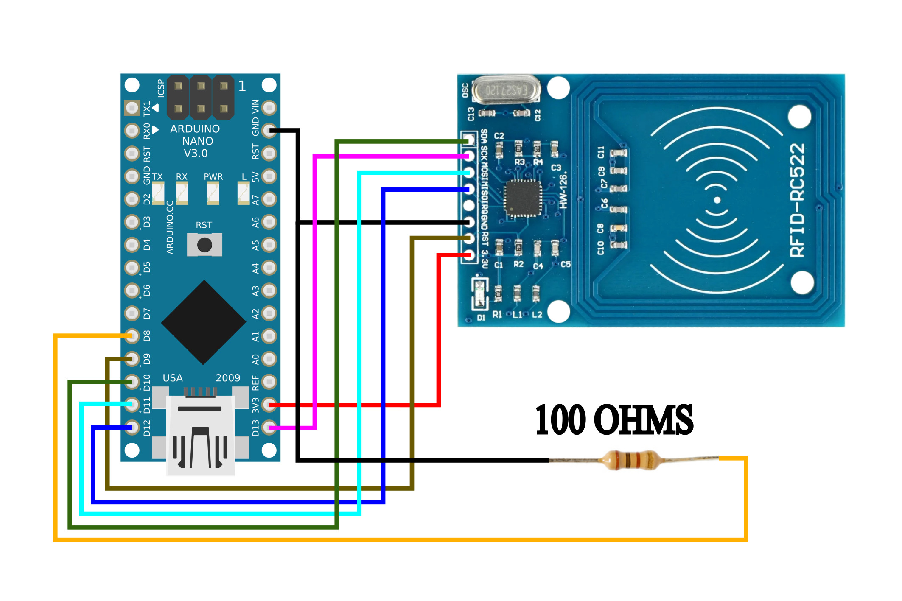
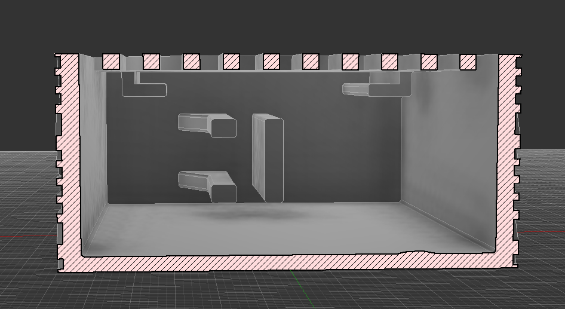
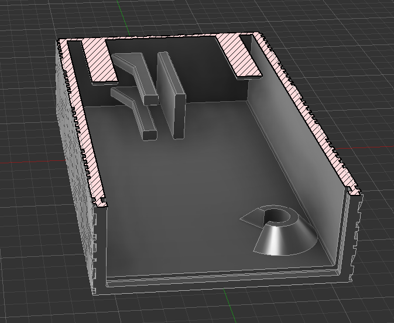

# Documentation hardware - FABSCAN

Cette documentation détaille la liste du matériel nécessaire, les instructions d'impression 3D ainsi que les étapes de câblage et d'assemblage du boîtier.

## 1. Liste du matériel

- **1x** Arduino Nano
- **1x** Module RFID RC522
- **1x** LED verte
- **1x** Résistance de 100 Ω
- **Lot de câbles** Dupont (femelle - femelle)
- **3x** Pièces imprimées en 3D (Boîtier, Porte, Support LED)
- **1x (optionnel)** Pièce imprimée en 3D (Logo)

## 2. Impression 3D des boîtiers

Les fichiers STL nécessaires à l'impression sont disponibles en téléchargement en cliquant sur **[ce lien](https://ecloud.myecl.fr/s/2JnsZxnKDqR7NKA)**, ou en scannant le QR code ci dessous :

### 2.1 Paramètres du Slicer (Trancheur)

L'architecture du boîtier et de son support a été optimisée pour minimiser l'utilisation de supports d'impression. 

#### Orientation des pièces
Pour un résultat optimal et économique en matériau, disposez les pièces de la manière suivante :

> Note : Pour mettre en valeur les logos, il est possible d'imprimer la pièce suivante, dans une couleur différente de celle du boitier. 

 

#### Gestion des supports
Seul le support de la LED nécessite des supports d'impression. Pour les placer précisément sans surcharger la pièce, utilisez l'option **"Peindre les supports"** de votre logiciel de trancheur, et peignez les de la manière suivante :

## 3. Câblage électronique

Effectuez les connexions en suivant le schéma ci-dessous.

 

## 4. Intégration des composants

Une fois l'impression terminée, nettoyez les pièces de leur supports, avant de procéder à l'intégration des composants électroniques.

 

Glissez les cartes dans leurs rails respectifs comme indiqué ci-dessous. Le module RFID se place dans la partie supérieure, tandis que l'Arduino Nano vient se loger juste en dessous.

 

La LED verte s'insère dans le support dédié, présent en bas de l'image :

