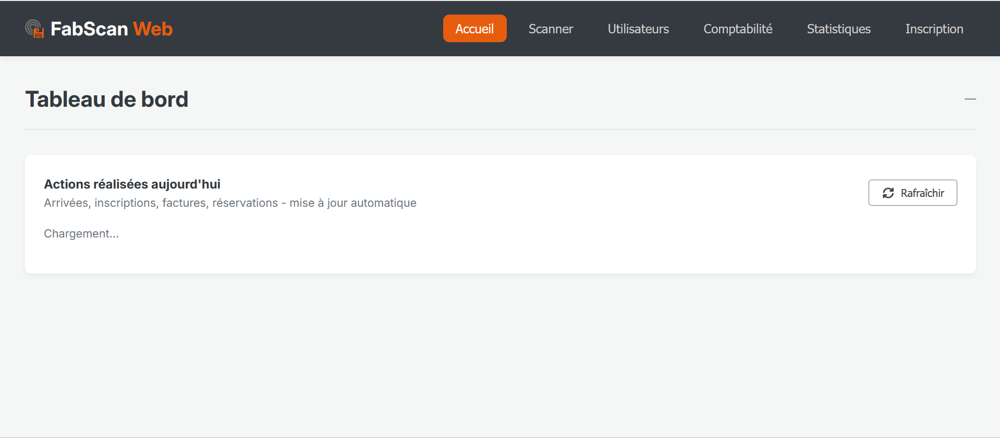
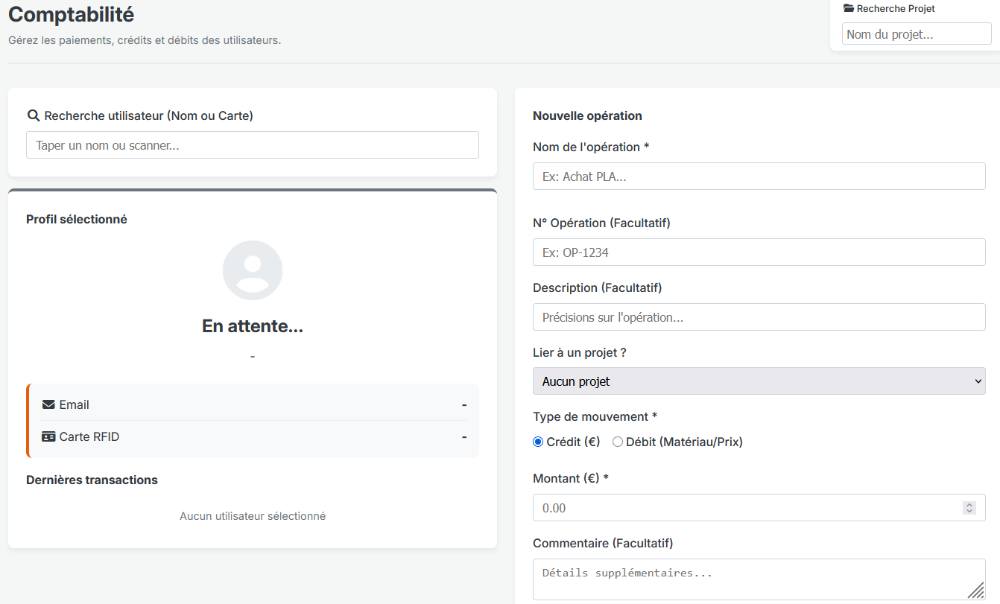
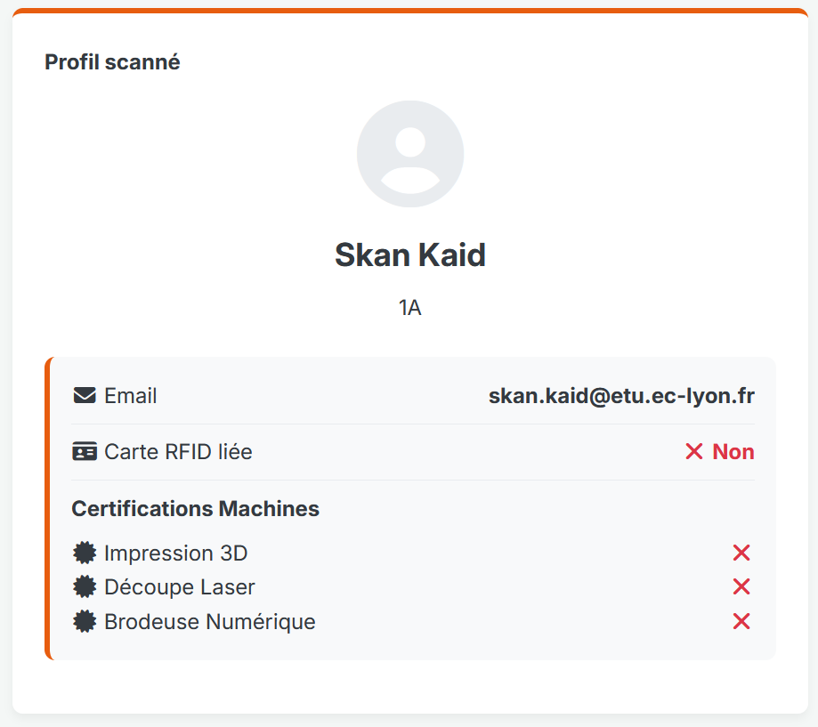
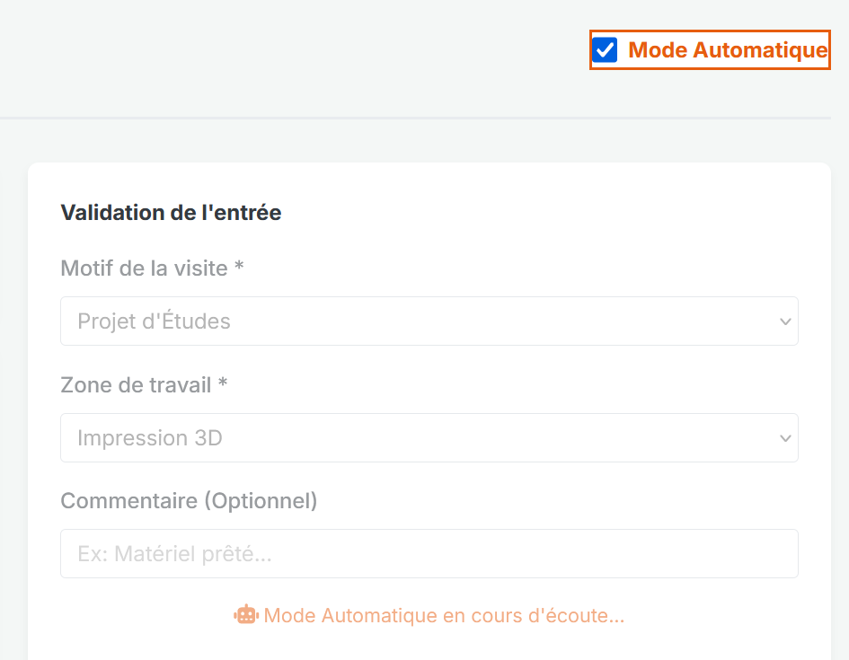

# TODO

[ ] Images : mettre des éléments en surbrillance et les numéroter
[ ] Images : mettre en situation réelle où les bases de données sont pleines à craquer 
[ ] Faire une FAQ

# Introduction

Cette documentation a pour objet de présenter le fonctionnement de l'application Web **FabScan** et les différentes fonctionnalités qu'elle contient.

Dans la suite du document, nous nous référerons à :
- le **FabLab**, qui désigne l'emplacement physique où se situe le dispositif **FabScan**. (*Voir la page [Wikipédia](https://fr.wikipedia.org/wiki/Fab_lab) pour plus de précisions.*)
- l'**Application**, qui désigne l'interface Web du dispositif.
- le **Personnel**, ou « Vous », ici considéré comme un.e gestionnaire de FabLab, qui utilise l'Application et à qui cette documentation s'adresse.
- l'**Utilisateur**, qui désigne un.e membre (externe au Personnel) qui utilise les installations du FabLab.
- le **Mode d'Identification**, qui désigne l'élément que l'Utilisateur va pouvoir utiliser pour s'identifier :
    - soit un QR code sur le téléphone de l'Utilisateur,
    - soit une carte multiservice (resp. carte étudiante, resp. carte de personnel resp. badge) en possession de l'Utilisateur.

# Prérequis
A partir de cette section, nous nous plaçons dans le cas où le Personnel vient de s'installer à son poste de travail au FabLab et souhaite utiliser l'Application. 
Le Personnel doit donc :
- allumer l'ordinateur sur lequel l'Application est installée et s'assurer qu'une connexion internet est disponible. 
- double-cliquer sur l'icône "FabScan" disponible sur le bureau. La fenêtre du terminal (fond noir) s'ouvre. Patienter jusqu'à ce que l'Application se lance automatiquement dans le navigateur par défaut. La page d'accueil de l'Application s'ouvre. L'Application est alors prête à être utilisée.

*Note liminaire :*
La connexion internet n'est pas indispensable pour le fonctionnement de l'Application, mais reste recommandée pour une utilisation optimale de l'ensemble des fonctionnalités, notamment pour la rubrique \ref{ref:Inscription_QR}. En cas de perte de connexion, l'Application continuera de fonctionner.

# Présentation de l'interface
*L'interface est conçue pour être intuitive et facile à utiliser, même pour les personnes qui ne sont pas familières avec les technologies numériques. Chaque onglet est décrit en détail dans les sections suivantes. La description se fera graduellement de haut en bas et accompagnée de captures d'écran.*

L'Application est composée de plusieurs onglets, chacun correspondant à une fonctionnalité spécifique. Ces onglets sont accessibles via la barre de navigation située en haut de la page. L'onglet *Accueil* est celui qui s'affiche par défaut à l'ouverture de l'Application.

Les onglets sont les suivants : *Accueil*, *Scanner*, *Utilisateurs*, *Comptabilité*, *Statistiques* et *Inscription*.
L'onglet actif est mis en évidence par un fond coloré.

## Onglet « Accueil »

Onglet par défaut de l'Application, il se charge à chaque nouveau lancement de l'Application.
 

L'*Accueil* se présente de la manière suivante :
- Le titre de l'onglet ("Tableau de bord") est affiché à gauche de la page. Un bouton cliquable "Mode Manuel" ainsi que la date et l'heure sont affichées à droite de l'écran.
Lorsque le bouton "Mode Manuel" est cliqué, il bascule sur "Mode Automatique" et inversement. Le mode automatique est expliqué dans la section \ref{ref:Mode_Automatique}.
- Des statistiques générales sur l'activité du FabLab sont affichées par la suite. Ces statistiques incluent : le nombre total d'entrées sur la dernière heure à compter de l'heure actuelle, le nombre d'entrées sur sur la date du jour, et le nombre d'utilisateurs inscrits au FabLab. Ces statistiques sont mises à jour en temps réel. Pour plus de détails sur les statistiques, veuillez vous référer à la section \ref{ref:Statistiques}.
- Un tableau récapitulatif des dernières entrées est affiché en bas de la page. Il contient les informations suivantes : l'heure d'entrée en vert, le nom et le prénom de l'Utilisateur, son statut, la zone de travail utilisée, le projet associé à l'entrée. Ce tableau est mis à jour en temps réel. Si l'entrée a été enregistrée en mode automatique, l'heure d'entrée sera affichée en rouge. Il est possible d'accéder à la fiche de l'Utilisateur en cliquant sur son nom. Pour plus de détails sur les entrées, veuillez vous référer à la section \ref{ref:Scanner}.

## Onglet « Scanner »

En cliquant sur l'onglet « Scanner », vous accédez à l'interface de gestion des entrées au FabLab. Cet onglet vous permet de scanner les badges (carte multiservice) ou QR codes des Utilisateurs et d'enregistrer leurs entrées dans la base de données.

La page de l'onglet « Scanner » se compose de deux parties principales : 
- à gauche: la zone d'affichage des informations de l'Utilisateur scanné ;
- à droite: la zone de saisie des informations de l'Utilisateur ;

Un bouton "Mode Automatique" est disponible en haut à droite de l'onglet. Il permet de basculer entre le mode manuel et le mode automatique pour l'enregistrement des entrées. Le mode automatique est expliqué dans la section \ref{ref:Mode_Automatique}.

A gauche :
Une barre de recherche est d'abord disponible en haut de la zone pour retrouver un Utilisateur par son nom ou son prénom, si l'Utilisateur n'a sur lui ni badge ni QR code.
Dans le cas très récurrent où un Utilisateur présente un QR code plutôt qu'un badge, il convient de cliquer sur le champ de saisie prévu à cet effet, puis de scanner le QR code avec le scanner. Le scan remplit la barre de recherche avec un identifiant unique de l'Utilisateur (et non son nom ou prénom).
Lorsqu'un champ (identifiant OU nom OU prénom) est rempli dans la barre de recherche, une ou plusieurs suggestions d'Utilisateur s'affichent en dessous. Il est possible de cliquer sur l'Utilisateur recherché pour afficher ses informations dans le cadre "Profil scanné".

Le cadre "Profil scanné" affiche les informations de l'Utilisateur identifié.
Lorsqu'un utilisateur n'est pas encore identifié, elle est "En attente de scan..." et les informations de l'Utilisateur ne sont pas affichées.
Les informations accessibles sont : 
- le prénom, le nom.
- le statut
- le solde (se référer à la section \ref{ref:Comptabilite} pour plus de détails sur le solde)
- la carte RFID (associée ou non à l'Utilisateur)
- les certifications machines (associées ou nonà l'Utilisateur)

A droite : 
Un cadre Validation de l'entrée est disponible. Il contient les champs suivants :
- un menu déroulant pour sélectionner le motif de la visite (obligatoire)
- un menu déroulant pour sélectionner la zone de travail (obligatoire)
- un champ de texte pour saisir un commentaire (optionnel)
- un bouton "Valider l'entrée" pour enregistrer l'entrée de l'Utilisateur dans la base de données.

## Onglet « Utilisateurs »

Cet onglet sert à l'affichage, la recherche, gestion des informations des différents Utilisateurs présents dans la base de données. 

L'onglet « Utilisateurs » se compose de deux parties principales :
- à gauche : la zone d'affichage des informations de l'Utilisateur sélectionné ;
- à droite : la zone de recherche et le tableau des Utilisateurs ;

Un bouton "Ajouter un Utilisateur" est disponible en haut à droite de l'onglet. Il permet d'accéder à l'onglet « Inscription » pour créer un nouveau profil d'Utilisateur. L'onglet « Inscription » est expliqué dans la section \ref{ref:Inscription}.

A gauche :
Lorsqu'un Utilisateur est sélectionné dans le tableau de droite, ses informations s'affichent dans le cadre "Profil Utilisateur". Toutes les informations connues y apparaissent et sont modifiables depuis ce cadre. On y voit :
- le QR code de l'Utilisateur associé à son identifiant unique;
- les informations de base : le prénom, le nom, l'e-mail et le statut de l'Utilisateur ;
- l'identifiant de la carte RFID associée à l'Utilisateur (si elle existe). Il est possible de retirer la carte (en cliquant sur l'icône corbeille) ou d'en associer une nouvelle (en cliquant sur Modifier la carte). Le bouton "Modifier la carte" permet également d'associer une carte RFID à l'Utilisateur s'il n'en a pas encore. Il est important de ne pas oublier de sauvegarder les modifications après avoir associé une nouvelle carte.
- les certifications machines associées à l'Utilisateur (si elles existent). Il est possible de cocher ou décocher les certifications machines pour l'Utilisateur. Il est important de ne pas oublier de sauvegarder les modifications après avoir modifié les certifications machines.
- Un bouton Sauvegarder pour enregistrer les modifications apportées aux informations de l'Utilisateur.
- Un bouton "Envoyer le QR" pour renvoyer le QR code à l'Utilisateur par e-mail. La procédure d'envoi du QR code est expliquée dans la section \ref{ref:Envoyer le QR}.
- Un bouton rouge "Supprimer cet utilisateur" pour supprimer l'Utilisateur de la base de données. La suppression d'un Utilisateur est irréversible et nécessite une confirmation avant d'être effectuée. Cette confirmation apparaît sous la forme d'une fenêtre pop-up demandant au Personnel de confirmer la suppression. Il est important de noter que la suppression d'un Utilisateur entraîne la perte de toutes les informations associées à ce profil. Les entrées sont affectées dans la mesure où le nom et prénom sont supprimés, mais le statut est conservé. Une entrée précédent la suppression d'un Utilisateur sera tout de même comptabilisée, le nom et prénom seront remplacés par "Membre supprimé". Les paiements ne sont en revanche pas affectés par la suppression d'un Utilisateur. Une transaction d'un Utilisateur supprimé sera quand même affichée et ses informations seront conservées.
- L'historique des paiements de l'Utilisateur, qui permet de consulter les dernières transactions liées à cet Utilisateur. L'historique des paiements est expliqué dans la section \ref{ref:Comptabilite}.

A droite
La table des Utilisateurs affiche la liste de tous les Utilisateurs présents dans la base de données. Il est possible de rechercher un Utilisateur par son nom, prénom ou e-mail grâce à la barre de recherche située en haut du tableau. Il est également possible de filtrer les Utilisateurs par statut grâce au menu déroulant situé à côté de la barre de recherche. Le tableau affiche les informations suivantes pour chaque Utilisateur : le prénom, le nom, et le statut. Il est possible de cliquer sur un Utilisateur pour afficher ses informations dans le cadre "Profil Utilisateur" à gauche dont la description est donnée ci-dessus.
Deux boutons "Précédent" et "Suivant" sont disponibles en bas du tableau pour naviguer entre les pages de la liste des Utilisateurs. Le nombre d'Utilisateurs affichés par page est limité à 20.

## Onglet « Comptabilité »

Cet onglet vous permet de gérer les transactions financières des Utilisateurs. Vous pouvez enregistrer des paiements, ajouter un montant (calculé en équivalent Matériau) au solde d'un Utilisateur, ou encore consulter l'historique des transactions d'un Utilisateur ou d'un Projet.

L'onglet « Comptabilité » se compose de deux parties principales, assez similaires à l'onglet « Scanner » ; ainsi qu'une troisième partie en bas de page :
- à gauche : la zone d'affichage des informations de l'Utilisateur sélectionné ;
- à droite : la zone de saisie des informations de l'Utilisateur et d'enregistrement des transactions.
- en bas de page : l'historique des transactions, qui permet de consulter les dernières transactions enregistrées dans la base de données.

Une barre de recherche est disponible en haut de la zone de gauche pour retrouver un Utilisateur par son nom ou son prénom, si l'Utilisateur n'a sur lui ni badge ni QR code. Dans le cas très récurrent où un Utilisateur présente un QR code plutôt qu'un badge, il convient de cliquer sur le champ de saisie prévu à cet effet, puis de scanner le QR code avec le scanner. Le scan remplit la barre de recherche avec un identifiant unique de l'Utilisateur (et non son nom ou prénom). Lorsqu'un champ (identifiant OU nom OU prénom) est rempli dans la barre de recherche, une ou plusieurs suggestions d'Utilisateur s'affichent en dessous. Il est possible de cliquer sur l'Utilisateur recherché pour afficher ses informations dans le cadre "Profil sélectionné".

A gauche :
Le cadre "Profil sélectionné" affiche les informations de l'Utilisateur identifié. Lorsqu'un utilisateur n'est pas encore identifié, elle est "En attente..." et les informations de l'Utilisateur ne sont pas affichées.
Les informations accessibles sont :
- le prénom, le nom.
- le statut
- le solde (se référer à la section \ref{ref:Comptabilite} pour plus de détails sur le solde)
- l'e-mail de l'Utilisateur
- l'information si l'Utilisateur possède une carte RFID associée ou non
- Les dernières transactions de l'Utilisateur, avec le nom de la transaction, la date, le projet lié à la transaction (si applicable), et le montant de la transaction.

A droite :
Un formulaire de saisie est disponible pour enregistrer une nouvelle transaction pour l'Utilisateur sélectionné. Le formulaire contient les champs suivants :
- le nom de l'opération (obligatoire)
- le numéro d'opération (optionnel) - très souvent lié à des opérations bancaires internes à l'établissement.
- une description (optionnelle)
- Un menu déroulant pour sélectionner le type de projet (obligatoire). Par défaut, le type de projet est "Aucun projet". Si un projet est sélectionné, il est possible de saisir le nom du projet (obligatoire) et le responsable du projet (optionnel). Le nom du projet peut-être un nom ou un numéro de projet. Le champ "Nom du projet" est muni (comme pour la barre de recherche d'un Utilisateur) d'une fonctionnalité de recherche pour retrouver un projet existant dans la base de données, si un projet a déjà été entré auparavant. 
Dans le cas où le projet a déjà été entré auparavant, il est possible de le sélectionner dans la liste de suggestions qui s'affiche. Le responsable de projet est alors automatiquement rempli. Le responsable du projet peut être un nom et/ou un prénom.
- Type de mouvement (obligatoire) : Crédit ou Débit. Le type de mouvement détermine si le montant saisi sera ajouté ou retiré du solde de l'Utilisateur. 
Dans le cas d'un mouvement de type Crédit (Ajout), il est possible de sélectionner un matériau (optionnel), une quantité ou un poids (obligatoire si matériau choisi), et le prix est calculé automatiquement en fonction du matériau et de la quantité/poids saisis. Le prix est affiché en temps réel dans le formulaire dans le champ suivant "Montant final de l'opération".
Dans le cas d'un mouvement de type Débit (Retrait), il est possible de sélectionner un matériau (optionnel), une quantité ou un poids (obligatoire si matériau choisi), et le prix est calculé automatiquement en fonction du matériau et de la quantité/poids saisis. Le prix est affiché en temps réel dans le formulaire dans le champ suivant "Montant final de l'opération"
- Le champ Montant final de l'opération est affiché en temps réel dans le formulaire. Il est calculé automatiquement en fonction du type de mouvement, du matériau et de la quantité/poids saisis. Le montant final de l'opération est affiché en euros (€) avec deux décimales. Il est possible de saisir un montant directement dans le champ "Montant final de l'opération" si le type de mouvement est Crédit (resp. Débit). Dans ce cas, le montant saisi sera ajouté (resp. retiré) au solde de l'Utilisateur.
- Un champ de texte pour saisir un commentaire (optionnel)
- Un bouton "Enregistrer l'opération" pour enregistrer la transaction dans la base de données. Si le formulaire n'est pas correctement rempli, un message d'erreur s'affiche et la transaction n'est pas enregistrée. Si le formulaire est correctement rempli, la transaction est enregistrée et l'historique des transactions de l'Utilisateur est mis à jour.

En bas de page :
L'historique des transactions affiche les dernières transactions enregistrées dans la base de données. 

Dans le tableau de l'historique des transactions :

Il est possible de filtrer les transactions par type de projet.
Il est également possible de filtrer les transactions par nom de projet grâce à la barre de recherche située en haut du tableau. Après avoir saisi le nom du projet, il est nécessaire de cliquer sur le bouton "Rechercher" pour appliquer le filtre. Le bouton "Réinitialiser les filtres" permet de retirer le filtre et d'afficher toutes les transactions.
Le tableau affiche les informations suivantes pour chaque transaction : la date, le nom de l'Utilisateur, le type de Projet, le nom du Projet (ou le numéro), le montant, le type de mouvement, et le nom de l'opération. Il est possible de cliquer sur une transaction pour afficher ses détails (et donc l'ensemble des information recueillies) dans un panneau latéral. Le panneau latéral peut être retiré en cliquant sur le bouton "Fermer" en haut à droite du panneau. 

Un bouton "Exporter l'historique" est disponible pour exporter l'historique des transactions au format CSV (lisible sur LibrOffice, Excel, etc.). Le fichier CSV contient toutes les informations enregistrées pour chaque transaction. Les informations sont les suivantes : Date, Heure,	Nom,	Prénom,	Nom de l'Opération,	N° Opération,	Moyen de paiement,	Nom Projet,  Type Projet,	Tuteur	, Matériau	, Quantité	, Mouvement	(Crédit ou Débit), Montant,	Description,	Commentaire. Les filtres appliquées dans l'historique des transactions sont également appliqués à l'exportation. Le fichier CSV est enregistré dans le dossier "Téléchargements" de l'ordinateur utilisé pour accéder à l'Application sous le nom "Transactions_FabLab.csv".

## Onglet « Statistiques »

Cet onglet vous sert à **suivre l’activité du FabLab**. Il rassemble les entrées, les profils d’utilisateurs et les passages récents pour vous aider à analyser la fréquentation selon la période choisie et les filtres appliqués.

1. Commencez par ouvrir la zone **Filtres d’analyse** si elle est repliée, puis choisissez la **période** que vous souhaitez observer avec le menu dépliant : aujourd’hui, les 7 derniers jours, les 30 derniers jours ou les 12 derniers mois. Vous pouvez ensuite préciser la **zone de travail**, le **motif de visite**, le **statut** ou même une **certification machine**.

2. Une fois vos filtres définis, cliquez sur **Appliquer les filtres** ou **Actualiser** pour mettre les données à jour. Les indicateurs en haut de page vous donnent alors une lecture rapide du nombre d’entrées sur la période, du volume observé et du nombre de membres correspondants.

3. Le bloc **Activité temporelle** vous montre l’évolution des passages sur la période sélectionnée. Il est utile pour repérer les journées plus calmes, les pics d’activité ou l’effet d’un événement particulier au FabLab. 

4. La section **Répartition par profils** vous aide à voir quels types d’utilisateurs fréquentent le plus le lieu. C’est pratique pour comprendre si le FabLab attire surtout certains statuts, et d'une manière plus poussée pour adapter l’accueil ou les créneaux d’ouverture.

5. Le tableau **Dernières entrées filtrées** affiche les 20 passages les plus récents correspondant à votre recherche. Vous y retrouvez le nom, le profil, la zone utilisée et le projet associé à chaque entrée, ce qui permet de vérifier rapidement les derniers mouvements enregistrés. 

6. Le bouton **Réinitialiser** vous permet de revenir à l’affichage initial (le même que quand vous arrivez sur l'onglet). Le bouton **Exporter l'historique** sert à télécharger les données en format `.csv` pour les exploiter dans un tableur ou les intégrer à un compte-rendu.

## Onglet « Inscription »

Lorsqu'un Utilisateur entre au FabLab et ne s'est pas encore identifié pour la première fois (i.e. n'est pas présent dans la base de données), il vous faudra l'inscrire en utilisant l'onglet Inscription. Cet ongleet vous permet de créer sa fiche en renseignant ses informations rapidement, afin qu’il soit reconnu lors de ses prochaines visites.

1. Commencez par choisir son **statut** dans le menu déroulant. Ensuite, renseignez son **prénom** et son **nom** dans les zones de texte. Choisissez ensuite le **motif de la visite** (comme pour l'onglet « Scanner »).
(*PS: le choix du statut sert aussi à adapter automatiquement l’adresse e-mail proposée, pour éviter de la saisir à la main.*)

2. Si l'Utilisateur doit utiliser une carte d’accès physique, cliquez sur **Associer la carte** puis faites passer le badge. La carte sera liée à l'Utilisateur, ce qui facilitera ses futurs passages. 

3. Laissez l’option **Envoyer le QR code par email** cochée si vous souhaitez que la personne reçoive un QR code par e-mail. (Ceci peut être un mode d'Identification en plus de la carte physique.)

4. Une fois que toutes les informations ont été vérifiées, cliquez sur **Enregistrer l’utilisateur** pour valider l’inscription.

# Déroulement d'une entrée au FabLab
Deux possibilités s’offrent à vous pour enregistrer l’entrée d’un Utilisateur au FabLab : le **Mode manuel** et le **Mode automatique**. Le mode manuel est celui par défaut, mais vous pouvez basculer sur le mode automatique en cliquant sur le bouton « Mode Automatique » situé en haut à droite de l’onglet « Accueil » ou « Scanner ».

## Mode manuel
Lorsqu’un Utilisateur entre au FabLab, il faudra basculer sur l’onglet « Scanner » ; la page suivante s’affiche :
1. Demander à l'Utilisateur les informations suivantes, que vous renseignerez dans les listes déroulantes : **un motif de visite** ainsi qu'une **zone de travail** dans laquelle l’Utilisateur souhaite travailler.

Le motif de la visite ainsi que la zone de travail sont des champs obligatoires. Le commentaire est optionnel ; vous pouvez le renseigner grâce à la zone de texte prévue à cet effet. 

2. Inviter l’Utilisateur à passer sa **Carte** sur le boîtier. Lorsque la carte est détectée, la fiche de l’Utilisateur s’affichera sur le côté gauche de l’écran, comme suit : 

3. Avant de valider l’entrée, s’assurer que l’Utilisateur possède bien les **Certifications Machine** nécessaires à l’utilisation des machines relatives à la zone de travail donné par l’Utilisateur. Une fois que les champs sont entrés, cliquer sur le bouton « Valider l’entrée ».

## Mode automatique

En cliquant sur la boîte **Mode automatique**, vous pouvez activer le mode automatique. Il est assez simple de voir si ce mode est activé par le fait que la partie **Validation de l'entrée** se grise. 

Dans ce mode, vous n'avez pas à renseigner les informations des Utilisateurs. Chaque badge scanné est comptabilisé dans la base de données sans information complémentaire sur la zone de travail ou le motif de visite.
