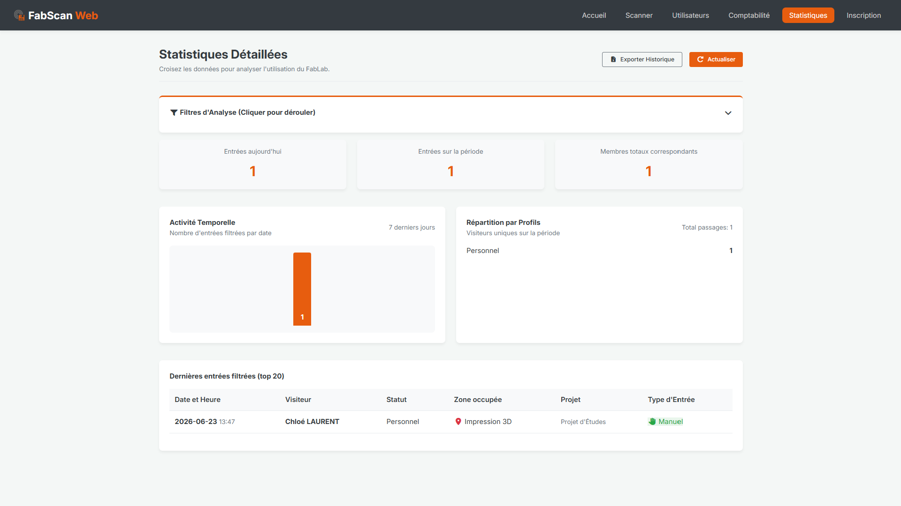
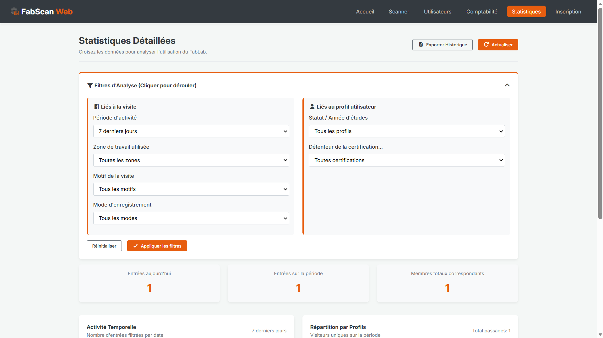
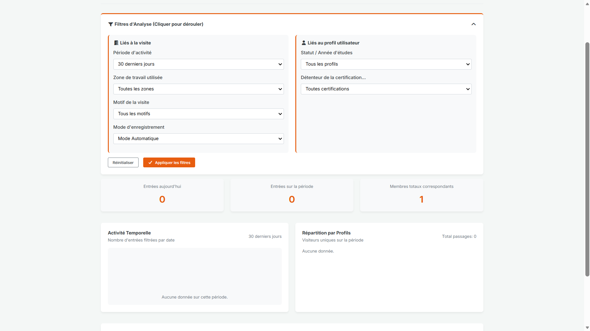

# FabScan - Documentation Utilisateur (version complète)

<table style="width: 100%; border: none; border-collapse: collapse; margin-bottom: 30px;">
  <tr>
    <td style="width: 60%; vertical-align: top; border: none; padding-right: 20px;">
      <strong>Version du document :</strong> 23/06/2026 
      <strong>Public cible :</strong> Personnel de FabLab (gestionnaires) 
      <strong>Objet :</strong> Manuel d'utilisation quotidienne de l'application FabScan
    </td>
    <td style="width: 40%; vertical-align: top; border: none; border-left: 2px solid #ddd; padding-left: 20px; text-align: left;">
      <small>
        <strong>Réalisé par l'équipe du PE-63 :</strong> 
        Skander Kaidali, Marceau Cottin, Hévan Rehel, Gabriel Sokolowski, Zaccary Nebout
      </small>
    </td>
  </tr>
</table>

---

## Table des matières

- [1. Introduction](#1-introduction)
- [2. Prérequis et démarrage](#2-prérequis-et-démarrage)
- [3. Présentation générale de l'interface](#3-présentation-générale-de-linterface)
- [4. Onglet Accueil](#4-onglet-accueil)
- [5. Onglet Scanner](#5-onglet-scanner)
- [6. Onglet Utilisateurs](#6-onglet-utilisateurs)
- [7. Onglet Comptabilité](#7-onglet-comptabilité)
- [8. Onglet Statistiques](#8-onglet-statistiques)
- [9. Onglet Inscription](#9-onglet-inscription)
- [10. Mise en pratique](#10-mise-en-pratique)
- [11. Déroulement d'une entrée au FabLab](#11-déroulement-dune-entrée-au-fablab)
- [12. Procédures liées](#12-procédures-liées)
- [13. Foire Aux Questions (FAQ)](#13-foire-aux-questions-faq)

 

## 1. Introduction

Ce document détaille le fonctionnement opérationnel de l'application Web **FabScan** et couvre l'exhaustivité de ses fonctionnalités d'administration.

### 1.1 Définitions et terminologie

Afin de faciliter la compréhension des procédures, les termes suivants seront employés :

- **FabLab** : Espace physique intégrant le dispositif matériel et logiciel FabScan.
- **Application** : Interface Web de pointage et de gestion du dispositif FabScan.
- **Personnel** (ou Vous) : Gestionnaire ou animateur du FabLab habilité à administrer l'Application.
- **Utilisateur** : Membre ou visiteur (externe au Personnel) exploitant les ressources du FabLab.
- **Mode d'identification** : Support permettant à l'Utilisateur d'authentifier sa présence (QR code numérique sur smartphone, carte multiservice, carte étudiante ou badge RFID).

### 1.2 Navigation rapide

- Pour un guide pas à pas de l'inscription : [Voir 10.1 Inscription d'un utilisateur](#101-inscription-dun-utilisateur-procédure-rapide).
- Pour l'enregistrement standard des flux : [Voir 11. Déroulement d'une entrée au FabLab](#11-déroulement-dune-entrée-au-fablab).
- Pour la gestion des comptes : [Voir 9. Onglet Inscription](#9-onglet-inscription).

 

## 2. Prérequis et démarrage

Cette section détaille la procédure de démarrage de l'Application lors de la prise de poste du Personnel.

1. Démarrez l'ordinateur central gérant FabScan.
2. Assurez-vous que le poste est connecté au réseau (Ethernet ou Wi-Fi).
3. Double-cliquez sur le raccourci **FabScan** situé sur le bureau.
4. Une invite de commande (terminal noir) s'ouvre pour initialiser les services. **Veuillez patienter** sans fermer cette fenêtre.
5. L'Application s'ouvre automatiquement dans votre navigateur Web par défaut.

L'onglet **Accueil** s'affiche : le système de gestion est désormais opérationnel.

> **Note sur la connectivité :** Une connexion Internet n'est pas strictement indispensable au fonctionnement du pointage. En cas de coupure réseau, l'Application maintient ses fonctions d'enregistrement locales. Toutefois, la connexion est requise pour l'exploitation avancée (ex: envoi des QR codes par e-mail).

 

## 3. Présentation générale de l'interface

L'ergonomie de l'Application repose sur une barre de navigation supérieure segmentant les tâches métier en six onglets distincts :

- **Accueil** (Tableau de bord de l'activité en cours)
- **Scanner** (Pointage et vérification des accès)
- **Utilisateurs** (Annuaire et édition des profils)
- **Comptabilité** (Gestion des flux financiers)
- **Statistiques** (Analyse des données et exports)
- **Inscription** (Création et maintenance des accès)

L'onglet actuellement consulté est systématiquement mis en surbrillance.

### 3.1 Logique de navigation commune

La majorité des écrans de gestion s'articulent autour d'une disposition standardisée :
- Un panneau de **recherche et d'identification** (à gauche ou en en-tête).
- Une zone de **consultation de profil** affichant les données du membre sélectionné.
- Un formulaire de **saisie et de validation** dédié à l'action métier en cours.
- Des **tableaux d'historique** dynamiques et filtrables.

 
 

## 4. Onglet Accueil

Il s'agit de la vue par défaut de l'Application, agissant comme un moniteur de l'activité en temps réel.

### 4.1 Éléments de l'interface

- **En-tête :** Affiche la date, l'heure système et le bouton de bascule **Mode Manuel / Mode Automatique**.
- **Indicateurs de performance (KPI) :**
  - Entrées cumulées sur la dernière heure.
  - Entrées totales de la journée.
  - Effectif global des utilisateurs inscrits.
- **Journal d'activité :** Tableau consignant les entrées les plus récentes.

### 4.2 Points de contrôle

- L'ensemble des compteurs est actualisé de manière asynchrone (en temps réel) sans nécessiter de rafraîchissement manuel de la page.
- Au sein du journal d'activité, un clic sur le nom d'un Utilisateur redirige immédiatement vers sa fiche détaillée ([Voir 6. Onglet Utilisateurs](#6-onglet-utilisateurs)).
- Pour en savoir plus sur l'automatisation de l'accueil : [Voir 11.2 Mode automatique](#112-mode-automatique).

 

## 5. Onglet Scanner

L'interface "Scanner" est le point de contrôle physique du FabLab. Elle permet de valider la présence et l'autorisation d'utilisation des machines.

### 5.1 Architecture de la page

- **Panneau de gauche :** Outil de recherche et fiche d'identité du **Profil scanné**.
- **Panneau de droite :** Formulaire de **Validation de l'entrée**.
- **En-tête droit :** Interrupteur d'activation du **Mode Automatique**.

### 5.2 Identification d'un utilisateur

Le moteur de recherche unifié permet de retrouver un profil via quatre méthodes :
- Saisie textuelle du nom ou du prénom.
- Saisie de l'identifiant unique (ID).
- Scan optique du QR code via la douchette.
- Détection du badge RFID via le lecteur NFC.

Dès la détection, le système suggère le profil ou l'affiche instantanément.

### 5.3 Analyse du profil scanné

Lorsqu'une identité est confirmée, la fiche affiche les autorisations du membre :
- Prénom, nom et statut institutionnel.
- État du solde financier.
- Indicateur de liaison de la carte RFID.
- **Certifications machine** (marquées d'une coche verte si acquises).

Si la station est inactive, l'état indiqué est : *En attente de scan...*

### 5.4 Validation d'une entrée manuelle

Pour confirmer un accès, le Personnel doit renseigner le formulaire :
1. **Motif de visite** (menu déroulant obligatoire).
2. **Zone de travail** (menu déroulant obligatoire).
3. **Commentaire** (champ texte optionnel pour annotation).
4. Clic sur le bouton de confirmation **Valider l'entrée**.

> **Important :** Le processus opérationnel complet est détaillé dans la section [11. Déroulement d'une entrée au FabLab](#11-déroulement-dune-entrée-au-fablab).

 

## 6. Onglet Utilisateurs

Cet espace agit comme le gestionnaire d'annuaire (CRM) du FabLab.

### 6.1 Architecture de la page

- **Panneau de gauche :** Fiche d'édition détaillée du **Profil Utilisateur** sélectionné.
- **Panneau de droite :** Moteur de recherche avancé et répertoire sous forme de tableau.

### 6.2 Administration d'une fiche profil

La sélection d'un membre déverrouille les actions d'administration suivantes :
- Consultation du QR code personnel.
- Modification des données d'état civil (Prénom, Nom, E-mail, Statut).
- **Gestion RFID :** Révocation d'un badge perdu ou association d'une nouvelle carte via le bouton **Modifier la carte**.
- **Accréditations :** Ajout ou retrait des certifications machines.
- Historique des transactions comptables liées au membre.

 

**Boutons d'action :**
- **Sauvegarder :** Valide les modifications saisies.
- **Envoyer le QR :** Déclenche l'envoi de l'identifiant par courriel.
- **Supprimer cet utilisateur :** Procédure de suppression irréversible.

### 6.3 Moteur de recherche et navigation

- Requêtes acceptées : Nom, prénom ou adresse e-mail.
- Menu déroulant pour isoler une cohorte (filtrage par statut).
- La navigation s'effectue par bloc de 20 résultats via la pagination (**Précédent / Suivant**).

### 6.4 Impact de la suppression d'un profil

> **Sécurité des données :** La suppression d'un compte est irréversible. Pour garantir l'intégrité des statistiques annuelles, le système efface l'identité (qui devient "Membre supprimé") mais préserve la traçabilité des transactions financières et le statut d'usage des anciennes visites.

 

## 7. Onglet Comptabilité

L'onglet Comptabilité centralise la facturation des matériaux et la gestion des flux de caisse.

### 7.1 Architecture de la page

- **Panneau de gauche :** Identification et état financier du profil.
- **Panneau de droite :** Formulaire de saisie d'une nouvelle opération.
- **Registre inférieur :** Journal de bord des transactions globales.

 

### 7.2 Identification du payeur

Le processus de recherche hérite des mêmes caractéristiques que la borne d'accueil ([Voir 5.2 Identification d'un utilisateur](#52-identification-dun-utilisateur)). La fiche charge immédiatement le solde en cours et les cinq derniers mouvements du membre.

### 7.3 Saisie d'un mouvement financier

Le formulaire de droite structure l'opération comptable :
- **Nom de l'opération :** Libellé obligatoire (ex: "Achat PLA").
- **Numéro d'opération :** Référence de suivi bancaire (optionnel).
- **Liaison Projet :** Type de projet et Nom du projet. L'autocomplétion suggère les projets existants et pré-remplit le responsable (Tuteur).
- **Type de mouvement :** Sélection stricte entre **Crédit** (Rechargement) ou **Débit** (Achat).
- **Tarification automatisée :** La sélection d'un matériau couplée à un poids/quantité calcule automatiquement le montant final selon la grille tarifaire enregistrée.
- **Validation :** Le clic sur **Enregistrer l'opération** met à jour le solde instantanément.

### 7.4 Journal comptable et exportation

Le registre inférieur offre une vue exhaustive des flux :
- Outils de filtrage croisés (par type de projet ou nom exact).
- L'inspection détaillée d'une facture s'ouvre dans un volet latéral par simple clic sur une ligne.
- Le bouton **Exporter l'historique** génère un fichier tableur de la requête en cours (téléchargé sous le nom `Transactions_FabLab.csv`).

 

## 8. Onglet Statistiques

L'interface de reporting décisionnel. Elle agglomère les données brutes pour éditer des rapports de fréquentation.

### 8.1 Module de filtrage

Accessible via le panneau supérieur déroulant **Filtres d'analyse** :
- **Critères temporels :** Aujourd'hui, 7 jours, 30 jours, 12 mois.
- **Critères spatiaux et sociaux :** Zone de travail, motif, statut, certification, mode de saisie.

L'actualisation des données requiert de cliquer sur **Appliquer les filtres**.

### 8.2 Indicateurs de performance

Trois métriques réagissent dynamiquement aux filtres appliqués :
- Total des entrées du jour.
- Total des entrées sur l'amplitude temporelle choisie.
- Nombre de visiteurs uniques sur la période.

### 8.3 Analyse graphique

- **Histogramme (gauche) :** Visualisation de l'évolution du trafic par intervalles de temps.
- **Graphique de répartition (droite) :** Segmentation de l'audience selon le statut institutionnel.

### 8.4 Registre des accès filtrés

- Le tableau répertorie les 20 derniers pointages correspondant aux critères actifs.
- L'extraction des données brutes vers Excel/LibreOffice s'effectue via le bouton **Exporter l'historique** (fichier `Historique_Entrees_FabLab.csv`).

 
 

## 9. Onglet Inscription

Module d'intégration (Onboarding) pour la création et la maintenance des identités numériques.

### 9.1 Formulaire de création d'accès

La création d'un compte exige la saisie des champs suivants :
- **Statut** (Génère automatiquement le suffixe de l'adresse e-mail de l'établissement).
- **Prénom & Nom** (Obligatoires).
- **E-mail** (Éditable si le format généré nécessite une correction).
- **Motif de visite** (Catégorisation initiale).
- **Liaison RFID** (Facultative lors de l'inscription).

### 9.2 Délivrance du QR Code

Un clic sur le bouton « Enregistrer l'utilisateur » déclenche, après enregistrement, l'ouverture de votre client de messagerie par défaut (ex: Zimbra).

> **Sécurité & Authentification :** Lors de l'envoi, une fenêtre d'authentification (service CAS) de votre établissement peut s'ouvrir. Ces données de connexion transitent exclusivement par les serveurs sécurisés de l'établissement et ne sont en aucun cas collectées par l'Application FabScan. 

**Procédure d'expédition :**
1. Validez le contenu de l'e-mail.
2. Fais un **(CTRL+V)** ou un **(Clic droit + Coller)** dans le corps du texte pré-rédigé.
3. Expédiez le message et retournez sur l'Application.

 

### 9.3 Outils d'administration de bases de données

- **Importation de données :** Le bouton **Importer un fichier Excel historique (.xlsx)** est réservé aux opérations de migration ou d'initialisation massive des cohortes. Afin que l'importation se passe au mieux, il faut que le fichier Excel contienne trois colonnes: Nom, Prénom, et Statut. Le nombre de fenêtres n'est pas important, puisque notre Application balaye l'entièreté du fichier. Dans la majorité des cas, cet outil ne sera quasiment pas utilisé, mais reste disponible.
- **Maintenance réglementaire :** Conformément au RGPD de la CNIL, ce bouton purge les comptes inactifs depuis 5 ans et anonymise les données datant de plus d'un an.
  - *Protection :* Cette opération critique est verrouillée par une double boîte de dialogue et requiert le mot de passe de session de l'ordinateur de supervision. Cette identification se fait à l'aide d'un clé d'accès délivrée par Windows. Aucune donnée n'est collectée par l'Application lors de la réalisation de cette opération. Il convient de réaliser cette maintenance tous les ans, la date du **1er septembre** étant proposé à titre d'exemple.

 

## 10. Mise en pratique

### 10.1 Inscription d'un utilisateur (procédure rapide)

1. Naviguez vers l'onglet **Inscription**.
2. Renseignez la fiche d'identité (Statut, Prénom, Nom, E-mail, Motif).
3. (Optionnel) Cliquez sur "Associer la carte" puis demandez à l'Utilisateur de passer son badge vierge sur le lecteur pour l'associer.
4. Cliquez sur **Enregistrer l'utilisateur**.
5. Si le client de messagerie exige une connexion (CAS), identifiez-vous. Sinon, passez à l'étape suivante. 
   Une fois l'identification faite, votre boîte de messagerie institutionnelle apparaîtra. Fermez la fenêtre, et revenez sur le formulaire d'inscription, puis cliquez à nouveau sur "Renvoyer le QR Code". Passez à l'étape suivante.
6. Dans la fenêtre de rédaction du courriel, faites un **(CTRL+V)** ou **(Clic droit + Coller)** dans le corps du mail et procédez à l'envoi.

Pour une description complète des champs : [Voir 9. Onglet Inscription](#9-onglet-inscription).

### 10.2 Consultation des rapports d'activité

1. Ouvrez l'onglet **Statistiques**.
2. Déployez le menu **Filtres d'analyse**.
3. Croisez les critères de votre choix (ex: Zone d'Impression 3D, sur les 30 derniers jours).
4. Cliquez sur **Appliquer les filtres**.
5. Exploitez les KPI ou cliquez sur **Exporter l'historique** pour traiter les données sur Excel.

 

## 11. Déroulement d'une entrée au FabLab

L'architecture FabScan prévoit deux régimes de fonctionnement selon l'affluence.

 

### 11.1 Mode manuel (Accueil standard)

Ce régime assure une traçabilité optimale et garantit le contrôle humain des accréditations.

1. Positionnez-vous sur l'onglet **Scanner**.
2. Spécifiez en amont le **Motif de visite** et la **Zone de travail**.
3. Demandez à l'usager de présenter son badge ou son téléphone.
4. Analysez la fiche qui apparaît. **Assurez-vous que l'usager dispose de la certification requise** pour la zone demandée (icône verte).
5. Validez l'accès via le bouton **Valider l'entrée**.

### 11.2 Mode automatique (Borne libre-service)

Ce régime fluidifie l'accès en période de forte affluence en supprimant la vérification humaine.

1. Depuis la barre d'en-tête (Accueil ou Scanner), activez l'interrupteur **Mode Automatique**.
2. Le formulaire de droite se verrouille visuellement (grisé).
3. L'installation agit désormais comme une borne autonome : chaque scan enregistre une présence sans exiger de détails supplémentaires.

Pour reprendre le contrôle de l'accueil, désactivez simplement l'interrupteur pour restaurer le Mode Manuel.

 

## 12. Procédures liées

### 12.1 Paramétrage des filtres de données

Les fonctions de filtrage (disponibles en Statistiques et Comptabilité) requièrent systématiquement une validation manuelle.

1. Ajustez les menus déroulants selon votre cible d'analyse.
2. N'oubliez pas de presser le bouton **Appliquer les filtres** / **Rechercher** pour exécuter la requête.

### 12.2 Localisation des exports de données

L'ensemble des fichiers générés par les fonctions d'exportation de l'Application sont directement envoyés vers le dossier natif **Téléchargements** (Downloads) de votre système d'exploitation, sous le format standardisé `.csv`.

 

## 13. Foire Aux Questions (FAQ)

### 13.1 L'application est-elle dépendante d'une connexion Internet ?
Le pointage RFID et la gestion des bases de données locales fonctionnent en réseau fermé. Internet est cependant requis pour émettre des QR codes par messagerie ou consulter des liens externes.

### 13.2 Comment procéder si un membre ne reçoit pas son QR code ?
1. [Voir 6. Onglet Utilisateurs](#6-onglet-utilisateurs) pour retrouver le profil.
2. Vérifiez la validité de l'adresse e-mail inscrite.
3. Cliquez sur le bouton d'action **Envoyer le QR** pour forcer une nouvelle expédition.

### 13.3 Comment enregistrer un visiteur démuni de badge ou de téléphone ?
L'outil de recherche du **Scanner** est conçu pour pallier ce cas de figure. Saisissez manuellement son nom ou prénom pour forcer l'identification et valider son entrée. S'il n'est pas répertorié, passez par l'onglet Inscription.

 

### 13.4 La suppression d'un compte est-elle réversible ?
Non. Le RGPD impose une suppression stricte. L'action est irréversible.

### 13.5 À quoi correspondent les textes en rouge dans l'historique ?
Le code couleur identifie le canal d'enregistrement : le texte rouge signale une entrée captée de manière autonome ([Voir 11.2 Mode automatique](#112-mode-automatique)), tandis que le vert certifie un contrôle manuel par le Personnel.