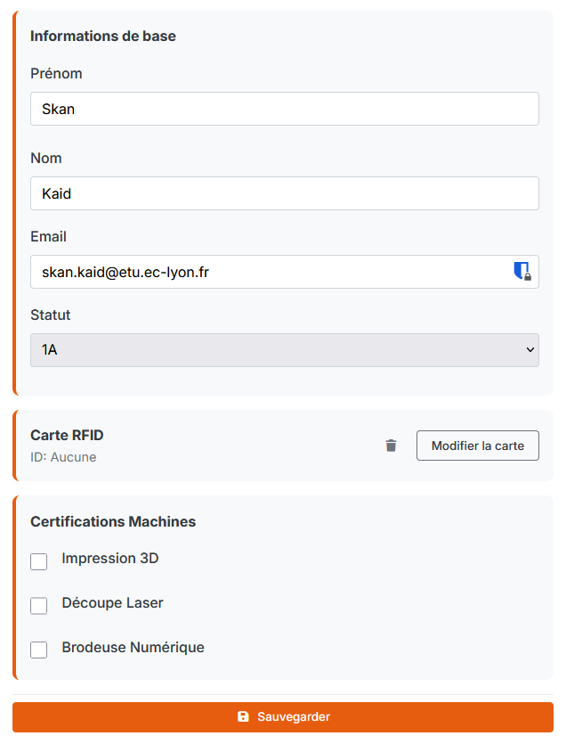
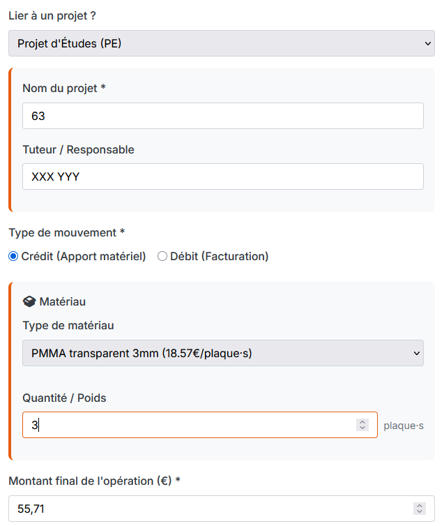
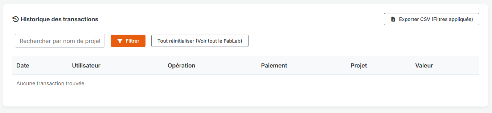

# TODO

[ ] Images : mettre des éléments en surbrillance et les numéroter
[ ] Images : mettre en situation réelle où les bases de données sont pleines à craquer 

# Introduction

Cette documentation a pour objet de présenter le fonctionnement de l'application Web **FabScan** et les différentes fonctionnalités qu'il contient.

Dans la suite du document, nous nous référerons à :
- le FabLab, qui désigne l'emplacement physique où se situe le dispositif **FabScan**. (*Voir la définition de [Wikipédia](https://fr.wikipedia.org/wiki/Fab_lab) si ce n'est pas clair.*)
- l'Application, qui désigne l'interface Web du dispositif.
- le Personnel, ou « Vous », ici considéré comme un.e gestionnaire de FabLab, qui utilise l'Application et à qui cette documentation s'adresse.
- l'Utilisateur, qui désigne un.e membre (externe au Personnel) qui utilise les installations du FabLab.
- le Mode d'Identification, qui désigne l'élément que l'Utilisateur va pouvoir utiliser pour s'identifier :
    - soit un code QR sur le téléphone de l'Utilisateur,
    - soit une carte multiservice (ayant un identifiant unique que l'on peut récupérer par RFID) en possession de l'Utilisateur.

# Fonctionnalités

Tous les onglets cités ci-après sont accessibles en cliquant sur le bouton correspondant dans la barre de navigation située en haut de la page.

## Onglet « Accueil »

Ceci est la page d'accueil sur lequel vous arrivez à chaque nouveau lancement de l'Application.
 

## Onglet « Scanner »

### Mode manuel

Lorsqu’un Utilisateur entre au FabLab, il faudra basculer sur l’onglet « Scanner » ; la page suivante s’affiche :

1. Demander à l'Utilisateur les informations suivantes, que vous renseignerez dans les listes déroulantes : **un motif de visite** ainsi qu'une **zone de travail** dans laquelle l’Utilisateur souhaite travailler.

Le motif de la visite ainsi que la zone de travail sont des champs obligatoires. Le commentaire est optionnel ; vous pouvez le renseigner grâce à la zone de texte prévue à cet effet. 

2. Inviter l’Utilisateur à passer sa **Carte** sur le boîtier. Lorsque la carte est détectée, la fiche de l’Utilisateur s’affichera sur le côté gauche de l’écran, comme suit : 

3. Avant de valider l’entrée, s’assurer que l’Utilisateur possède bien les **Certifications Machine** nécessaires à l’utilisation des machines relatives à la zone de travail donné par l’Utilisateur. Une fois que les champs sont entrés, cliquer sur le bouton « Valider l’entrée ».

### Mode automatique

En cliquant sur la boîte **Mode automatique**, vous pouvez activer le mode automatique. Il est assez simple de voir si ce mode est activé par le fait que la partie **Validation de l'entrée** se grise. 

Dans ce mode, vous n'avez pas à renseigner les informations des Utilisateurs. Chaque badge scanné est comptabilisé dans la base de données sans information complémentaire sur la zone de travail ou le motif de visite.

## Onglet « Utilisateurs »

Cet onglet sert à l'affichage, la recherche, gestion des différents Utilisateurs présents dans la base de données. 

L’onglet « Utilisateurs » vous permet de retrouver rapidement une personne déjà enregistrée, puis de consulter ou modifier sa fiche. C’est ici que vous gérez ses informations, ses modes d'Identification, ses certifications et son historique de paiements.

- Vous pouvez utiliser la barre de recherche pour retrouver une personne par son nom ou son prénom. Vous pouvez aussi affiner l’affichage avec le filtre par statut si vous cherchez un profil précis.

    - Cliquez ensuite sur la ligne de l’Utilisateur que vous cherchez dans le tableau. Un panneau s’ouvre sur la gauche avec son profil complet, ce qui vous permet de vérifier ses informations et de les corriger si besoin.

    

    - Dans la partie **Informations de base**, vous pouvez modifier son prénom, son nom, son e-mail et son statut. Cela vous sert par exemple à corriger une erreur de saisie ou à mettre à jour la situation de la personne.

    - La zone **Carte RFID** vous indique si un badge est déjà associé. Si nécessaire, vous pouvez soit retirer la carte avec l’icône Corbeille, soit cliquer sur **Associer une carte** pour enregistrer un nouveau badge, puis ne pas oublier de sauvegarder.

    - Dans **Certifications Machines**, cochez les machines ou compétences que l'Utilisateur est autorisée à utiliser. Cette partie vous aide à garder un suivi des accès et des autorisations au sein du FabLab.

- Le bouton Sauvegarder enregistre vos modifications. Si vous devez renvoyer le QR code à la l'Utilisateur, utilisez **Envoyer le QR**. Si le profil doit être supprimé, le bouton rouge **Supprimer cet utilisateur** permet de retirer l'Utilisateur de la base de données après confirmation.

- En bas du panneau, l’historique des paiements vous permet de consulter rapidement les dernières transactions liées à cet utilisateur. Cela vous donne une vue utile sur son suivi sans quitter l'onglet.

## Onglet « Comptabilité »

Lorsqu'un Utilisateur souhaite effectuer un paiement ou ajouter de l'argent à son solde, vous devrez ouvrir l’onglet « Comptabilité ». Cet onglet vous permet de rattacher une opération à un utilisateur et de garder une trace de ce qui a été crédité ou débité.

1. Commencez par **sélectionner l’utilisateur** dans la zone **Recherche utilisateur** à gauche, soit en tapant son nom, soit en scannant sa carte RFID. Dès qu’il est reconnu, son profil s’affiche en bas avec ses informations essentielles et ses dernières transactions.

2. Vous pouvez ensuite vérifier son **e-mail** et son **numéro de carte RFID** dans le panneau de profil. Cette vue vous aide à vous assurer que vous avez bien sélectionné la bonne personne avant d’enregistrer une opération.

3. Dans la zone **Nouvelle opération** (à droite), renseignez le **nom de l’opération**. Si besoin, ajoutez un numéro d’opération, une description ou un commentaire pour préciser le contexte, par exemple un achat de matériau ou une participation à un projet.

4. Si l’opération doit être liée à un **projet**, choisissez d’abord le type de projet, puis complétez le nom du projet et le responsable. Cette étape est utile pour retrouver facilement toutes les opérations associées à un projet donné.

5. Choisissez ensuite le **type de transaction**. En mode **Crédit**, vous saisissez simplement un montant (montant qui va être ajouté au solde); en mode **Débit** (montant qui va être retiré du solde), vous sélectionnez le matériau, la quantité ou le poids, puis le prix est calculé pour vous.

6. Une fois les informations saisies, cliquez sur **Enregistrer l’opération**. L’historique en bas de page se met à jour pour vous montrer l’ensemble des transactions, avec la date, l’utilisateur, le projet, le type de mouvement et la valeur correspondante.

Concernant l'historique des transactions : vous pouvez sélectionner toutes les transactions d'un seul projet en utilisant la zone de texte **Rechercher par nom de projet** puis en cliquant sur **Filtrer** pour filtrer l’historique et vous concentrer uniquement sur les opérations concernées par celui-ci. Le bouton **Tout réinitialiser** permet de retirer le filtre.

## Onglet « Statistiques »

Cet onglet vous sert à **suivre l’activité du FabLab**. Il rassemble les entrées, les profils d’utilisateurs et les passages récents pour vous aider à analyser la fréquentation selon la période choisie et les filtres appliqués.

1. Commencez par ouvrir la zone **Filtres d’analyse** si elle est repliée, puis choisissez la **période** que vous souhaitez observer avec le menu dépliant : aujourd’hui, les 7 derniers jours, les 30 derniers jours ou les 12 derniers mois. Vous pouvez ensuite préciser la **zone de travail**, le **motif de visite**, le **statut** ou même une **certification machine**.

2. Une fois vos filtres définis, cliquez sur **Appliquer les filtres** ou **Actualiser** pour mettre les données à jour. Les indicateurs en haut de page vous donnent alors une lecture rapide du nombre d’entrées sur la période, du volume observé et du nombre de membres correspondants.

3. Le bloc **Activité temporelle** vous montre l’évolution des passages sur la période sélectionnée. Il est utile pour repérer les journées plus calmes, les pics d’activité ou l’effet d’un événement particulier au FabLab. 

4. La section **Répartition par profils** vous aide à voir quels types d’utilisateurs fréquentent le plus le lieu. C’est pratique pour comprendre si le FabLab attire surtout certains statuts, et d'une manière plus poussée pour adapter l’accueil ou les créneaux d’ouverture.

5. Le tableau **Dernières entrées filtrées** affiche les 20 passages les plus récents correspondant à votre recherche. Vous y retrouvez le nom, le profil, la zone utilisée et le projet associé à chaque entrée, ce qui permet de vérifier rapidement les derniers mouvements enregistrés. 

6. Le bouton **Réinitialiser** vous permet de revenir à l’affichage initial (le même que quand vous arrivez sur l'onglet). Le bouton **Exporter l'historique** sert à télécharger les données en format `.csv` pour les exploiter dans un tableur ou les intégrer à un compte-rendu.

## Onglet « Inscription »

Lorsqu'un Utilisateur entre au FabLab et ne s'est pas encore identifié pour la première fois (i.e. n'est pas présent dans la base de données), il vous faudra l'inscrire en utilisant l'onglet Inscription. Cet ongleet vous permet de créer sa fiche en renseignant ses informations rapidement, afin qu’il soit reconnu lors de ses prochaines visites.

1. Commencez par choisir son **statut** dans le menu déroulant. Ensuite, renseignez son **prénom** et son **nom** dans les zones de texte. Choisissez ensuite le **motif de la visite** (comme pour l'onglet « Scanner »).
(*PS: le choix du statut sert aussi à adapter automatiquement l’adresse e-mail proposée, pour éviter de la saisir à la main.*)

2. Si l'Utilisateur doit utiliser une carte d’accès physique, cliquez sur **Associer la carte** puis faites passer le badge. La carte sera liée à l'Utilisateur, ce qui facilitera ses futurs passages. 

3. Laissez l’option **Envoyer le QR code par email** cochée si vous souhaitez que la personne reçoive un QR code par e-mail. (Ceci peut être un mode d'Identification en plus de la carte physique.)

4. Une fois que toutes les informations ont été vérifiées, cliquez sur **Enregistrer l’utilisateur** pour valider l’inscription.