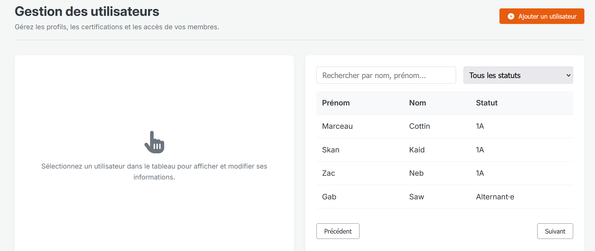

# Introduction

Cette documentation a pour objet de présenter le fonctionnement de l'application Web **FabScan** et les différentes fonctionnalités qu'il contient.

Dans la suite du document, nous nous référerons à :
- le FabLab, qui désigne l'emplacement physique où se situe le dispositif **FabScan**. (*Voir la définition de [Wikipédia](https://fr.wikipedia.org/wiki/Fab_lab) si ce n'est pas clair.*)
- l'Application, qui désigne l'interface Web.
- le Personnel, qui désigne la personne, ici considéré comme un.e gestionnaire de FabLab, qui utilise l'Application
- l'Utilisateur, qui désigne un.e membre (externe au Personnel) qui utilise les installations du FabLab.
- l'Identifiant, qui désigne le mode d'identification que l'Utilisateur va utiliser pour s'identifier :
    - soit un code QR sur le téléphone de l'Utilisateur,
    - soit une carte multiservice (ayant un identifiant unique que l'on peut récupérer par RFID) en possession de l'Utilisateur.

# Fonctionnalités

Tous les onglets cités ci-après sont accessibles en cliquant sur le bouton correspondant dans la barre de navigation située en haut de la page.
### Onglet « Accueil »

Ceci est la page d'accueil sur lequel vous arrivez à chaque nouveau lancement de l'Application.
 

### Onglet « Scanner »

Lorsqu’un Utilisateur entre au FabLab, il faudra basculer sur l’onglet « Scanner » ; la page suivante s’affiche :

1. Demander à l'Utilisateur les informations suivantes, que vous renseignerez dans les listes déroulantes : **un motif de visite** ainsi qu'une **zone de travail** dans laquelle l’Utilisateur souhaite travailler.

Le motif de la visite ainsi que la zone de travail sont des champs obligatoires. Le commentaire est optionnel ; vous pouvez le renseigner grâce à la zone de texte prévue à cet effet. 

2. Inviter l’Utilisateur à passer sa **Carte** sur le boîtier. Lorsque la carte est détectée, la fiche de l’Utilisateur s’affichera sur le côté gauche de l’écran, comme suit : 

3. Avant de valider l’entrée, s’assurer que l’Utilisateur possède bien les **Certifications Machine** nécessaires à l’utilisation des machines relatives à la zone de travail donné par l’Utilisateur. Une fois que les champs sont entrés, cliquer sur le bouton « Valider l’entrée ».

### Onglet « Utilisateurs »

Cet onglet sert à l'affichage, la recherche, gestion des différents Utilisateurs présents dans la base de données. 

- 

### Onglet « Inscription »

Lorsqu'un Utilisateur entre au FabLab et ne s'est pas encore identifié pour la première fois (i.e. n'est pas présent dans la base de données), il vous faudra l'inscrire en utilisant l'onglet Inscription. Cet ongleet vous permet de créer sa fiche en renseignant ses informations rapidement, afin qu’il soit reconnu lors de ses prochaines visites.

1. Commencez par choisir son **statut** dans le menu déroulant. Ensuite, renseignez son **prénom** et son **nom** dans les zones de texte. Choisissez ensuite le **motif de la visite** (comme pour l'onglet « Scanner »).
(*PS: le choix du statut sert aussi à adapter automatiquement l’adresse e-mail proposée, pour éviter de la saisir à la main.*)

2. Si l'Utilisateur doit utiliser une carte d’accès physique, cliquez sur **Associer la carte** puis faites passer le badge. La carte sera liée à l'Utilisateur, ce qui facilitera ses futurs passages. 

3. Laissez l’option **Envoyer le QR code par email** cochée si vous souhaitez que la personne reçoive un QR code par e-mail. (Ceci peut être un mode d'Identification en plus de la carte physique.)

4. Une fois que toutes les informations ont été vérifiées, cliquez sur **Enregistrer l’utilisateur** pour valider l’inscription.